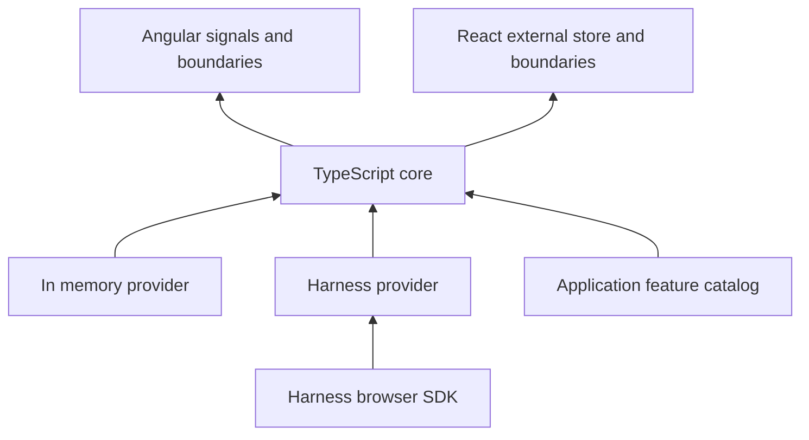

# Feature gate architecture

The library implements a framework independent local decision store. Providers supply normalized evaluations; Angular and React consume a reader interface. The root shell owns startup, evaluation identity changes, and cleanup.

The Harness runtime key selects its configured context. EvaluationContext contains targetId and optional attributes. No environment parameter or deployment enumeration exists in core or its framework adapters.

The initial proposal has been narrowed for the first executable release: no persistent cache or stale retention policy, boolean decisions only, explicit React shell ownership, and shared Angular signal subscriptions owned by the root service. These choices keep cleanup and fallback behavior testable without introducing more lifecycle modes.

Identity transitions synchronously invalidate old values before asynchronous cleanup and connection. Each transition increments a context revision. Obsolete connections cannot publish. Startup settlement is bounded independently of provider connection completion, permitting late recovery without duplicate initialization.

A complete provider load is committed to the core store before notifying subscribers. Immutable snapshots remain stable on no-op evaluations. This supports Angular reactive rendering and React external store requirements without framework dependencies in core.

UI boundaries instantiate only the selected branch. Route guards control matching, not ongoing screen lifetime. Business workflows retain responsibility for pinning strategies and protecting unsaved work. The generic library never turns a browser decision into an authorization guarantee.

Provider implementations must support abort and idempotent close. Diagnostics are isolated from runtime decisions. Provider cleanup errors are reported but do not expose raw error payloads to consumers. The Harness adapter handles SDK lifecycle and cancellation and validates fresh evaluation membership in addition to SDK variation results.

For source-level usage and verified behavior, see the root README and tests. For broader implementation rationale and planned extensions, see IMPLEMENTATION_APPROACH.md.
